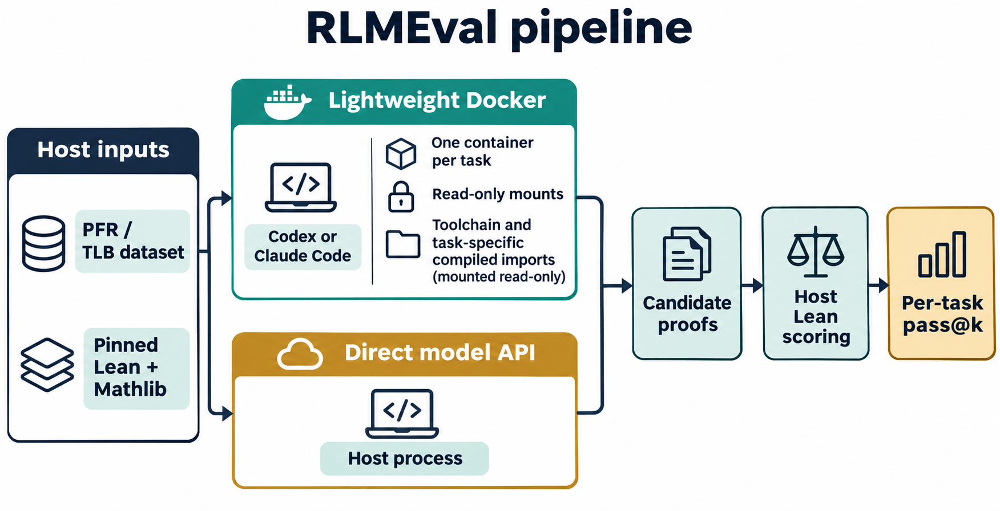

# RLMEval 生成与评测

使用 Codex 或 Claude Code 在独立的 Docker 容器中逐题生成 Lean 证明，随后由宿主机编译候选证明并汇总评分。原始题库随代码提供，位于 [RLMEval/data/rlm25_pfr_tlb.jsonl](RLMEval/data/rlm25_pfr_tlb.jsonl)。



首次使用请准备 Linux x86-64、可运行容器的 Docker 和 Python 3.11。以下依次介绍宿主机环境配置、从源码构建和正式评测。已有预构建发布包的用户可直接阅读文末的快速开始。

## 宿主机 Python 环境

在含有 `requirements.txt` 的仓库目录中，使用同一个 Bash 终端执行。宿主机使用 Python 3.11 读题、启动 Docker、收集结果和评分。

```bash
python3.11 -m venv "$HOME/.venvs/rlmeval"
source "$HOME/.venvs/rlmeval/bin/activate"
export PYTHON_BIN="$VIRTUAL_ENV/bin/python"
"$PYTHON_BIN" -m pip install -r requirements.txt
PYTHONPATH="$PWD/RLMEval/src" "$PYTHON_BIN" -c 'from rlm_agent.items import load_items; from rlm_agent.scoring import RepoScorer'
```

## 从源码构建

从 GitHub 克隆本仓库后，进入本 README 所在的目录，先完成上面的 Python 环境安装。宿主机需要 Linux、Docker（BuildKit）、Elan、git、rsync 和 Lean 项目的原生构建工具。首次构建使用空的 `dependencies/`。如需使用独立数据盘，将下面的 `RLMEVAL_DEPS` 设为该盘上的绝对路径。

镜像构建使用宿主机的 Linux x86-64 Codex 和 Claude Code。安装位置不同时，先设置 `CODEX_VENDOR`（含 `bin/codex` 和 `codex-path/` 的目录）和 `CLAUDE_BIN`（Claude 原生可执行文件）。构建需要 Python 3.12 基础镜像和 wheels，离线 wheels 可通过 `WHEEL_DIR` 指定。

```bash
export RLMEVAL_DEPS="$PWD/dependencies"
bash RLMEVAL-ADAPT/build/build-libraries.sh "$RLMEVAL_DEPS"
"$PYTHON_BIN" RLMEVAL-ADAPT/build/prepare.py --deps "$RLMEVAL_DEPS"
docker pull python:3.12-slim-bookworm
./RLMEVAL-ADAPT/docker/build.sh
```

第一步在随附的 PFR 和 TLB 源码目录中分别执行 `lake exe cache get` 和 `lake build`，获取锁定版本的 Mathlib 缓存并编译项目。第二步根据逐题清单校验项目模块，以硬链接生成每题的 `lib/`，并写出含本机评分路径的 `dataset.jsonl`。

从源码构建的镜像是 `rlmeval-native:light`。启动器从 `RLMEVAL_DEPS` 只读挂载本题对应的 Lean 工具链，并在该依赖盘上用临时硬链接汇集公共包的 .olean；每个容器仍只挂载一份单题输入。临时目录在本批次结束后清理。可通过 `RLMEVAL_DOCKER_IMAGE=rlmeval-native:light` 显式选择轻量镜像。轻量镜像实测约 1.79 GB（未压缩）。PFR 第 10 题和 TLB 第 174 题均通过离线编译预检；GLM-5.3 分别通过 Codex 和 Claude Code 生成的第 174 题候选均通过宿主机评分。换终端时，请重新导出该目录的绝对路径和 `PYTHON_BIN`。

## 生成方式与采样配置

| 生成方式 | 入口 | 模型服务配置 |
|---|---|---|
| Codex | Docker 启动器，`BACKEND=codex` | `MODEL`、`OPENAI_BASE_URL`、`OPENAI_API_KEY`，使用 Responses 接口 |
| Claude Code | Docker 启动器，`BACKEND=claude` | `MODEL`、`ANTHROPIC_BASE_URL`、`ANTHROPIC_API_KEY` 或 `ANTHROPIC_AUTH_TOKEN` |

**裸模型**使用宿主机脚本 `RLMEVAL-ADAPT/start-direct.sh`。安装本仓库的 `requirements.txt` 并准备好前述宿主机依赖和逐题数据后，在本 README 所在目录运行：

```bash
export MODEL=deepseek-v4.1-flash
export OPENAI_BASE_URL=https://token.pjlab.org.cn/v1
read -rsp 'API key: ' OPENAI_API_KEY; echo
export OPENAI_API_KEY
INDICES=1 SAMPLES=1 CONCURRENCY=1 ./RLMEVAL-ADAPT/start-direct.sh
```

裸模型使用 OpenAI 兼容的 Chat Completions API。启动器依次生成、评分、汇总，在 `RLMEVAL-ADAPT/runs/direct-*/` 下保存 `generations.jsonl`、`scores.jsonl`、`summary.json` 和 `summary.md`。配置集中在脚本顶部，同名环境变量优先。`SAMPLES` 是每题采样数，`CONCURRENCY` 是全批次同时生成的样本数，`MAX_OUTPUT_TOKENS` 是单次请求的输出上限。

Docker 示例：在启动前执行 `export INDICES=10,146 SAMPLES=4 CONCURRENCY=2 TMO=21600`。两个题目最多同时运行两个容器，每题在自己的容器中顺序生成 4 个样本，共 8 个候选；每个样本的超时为 21600 秒。

**逐题 pass@k** 由 `SAMPLES=k` 指定采样次数。该题的 k 个候选中至少一个通过评分，即记为该题通过。汇总中的 `observed_pass_at_k_rate` 是通过题数占汇总题数的比例。`CONCURRENCY` 控制同时运行的题数，不改变 k。

## 预检与正式评测

先设置本轮题号。预检只编译初始候选，不调用模型；正式评测沿用同一个 `INDICES`。

```bash
export INDICES=10,146
./RLMEVAL-ADAPT/start-docker.sh --prepare-only
```

预检通过后，选择一个后端，在同一终端设置模型和服务地址。下例以 Codex 的 Responses 接口为例，执行时输入实际值：

```bash
export BACKEND=codex
read -rp '模型名: ' MODEL
read -rp 'Responses API base URL: ' OPENAI_BASE_URL
read -rsp 'API key: ' OPENAI_API_KEY; echo
export MODEL OPENAI_BASE_URL OPENAI_API_KEY
./RLMEVAL-ADAPT/start-docker.sh
```

使用 Claude Code 时，设置 `BACKEND=claude`、`MODEL`、`ANTHROPIC_BASE_URL` 以及 `ANTHROPIC_API_KEY` 或 `ANTHROPIC_AUTH_TOKEN`，然后运行同一个启动脚本。采样数、并发和超时可分别用 `SAMPLES`、`CONCURRENCY` 和 `TMO` 设置。每题使用独立容器，题内样本顺序运行；宿主机收集并评分，结果写入 `RLMEVAL-ADAPT/runs/<RUN_ID>/`。

首次评分时，宿主机上的 lean-interact 需要获取与 Lean 版本匹配的 REPL，或使用预先准备的缓存。

## 快速开始：从对象存储获取依赖，构建轻量镜像

代码和题库从 GitHub 获取。已编译的 Elan、Lean、PFR/TLB 和 Mathlib 已上传至 PJLab HDD2 对象存储的 `s3://agentsft1/MathEval_yrh/rlmeval-dependencies.tar.gz`（约 4.8 GiB）。使用这份依赖包即可跳过下载和编译 Mathlib。生成端使用轻量镜像 `rlmeval-native:light`。

在具有桶读取权限并能访问 HDD2 的环境中配置 AWS CLI 凭据。从本 README 所在目录执行：

```bash
export DIST="$HOME/Downloads/rlmeval"
mkdir -p "$DIST"
endpoint=http://hdd2.h.pjlab.org.cn:8060
prefix=s3://agentsft1/MathEval_yrh
for file in rlmeval-dependencies.tar.gz rlmeval-dependencies.tar.gz.sha256; do
  aws --endpoint-url "$endpoint" s3 cp "$prefix/$file" "$DIST/$file"
done
(cd "$DIST" && sha256sum -c rlmeval-dependencies.tar.gz.sha256)
```

校验通过后，在同一终端完成前文的宿主机 Python 环境配置，并准备好「从源码构建」中列出的 Codex 和 Claude Code 可执行文件。将依赖解压到空目录，生成逐题输入，并构建只包含 harness 和运行代码的镜像：

```bash
export RLMEVAL_DEPS="$PWD/dependencies"
mkdir -p "$RLMEVAL_DEPS"
tar -xzf "$DIST/rlmeval-dependencies.tar.gz" -C "$RLMEVAL_DEPS"
"$PYTHON_BIN" RLMEVAL-ADAPT/build/prepare.py --deps "$RLMEVAL_DEPS"
export RLMEVAL_DOCKER_IMAGE=rlmeval-native:light
docker pull python:3.12-slim-bookworm
./RLMEVAL-ADAPT/docker/build.sh
```

接下来按[预检与正式评测](#预检与正式评测)运行。同一对象存储目录此前上传的 `rlmeval-images.tar.gz` 是旧版 `portable` 镜像归档；上述轻量流程只下载依赖包及其校验文件。
